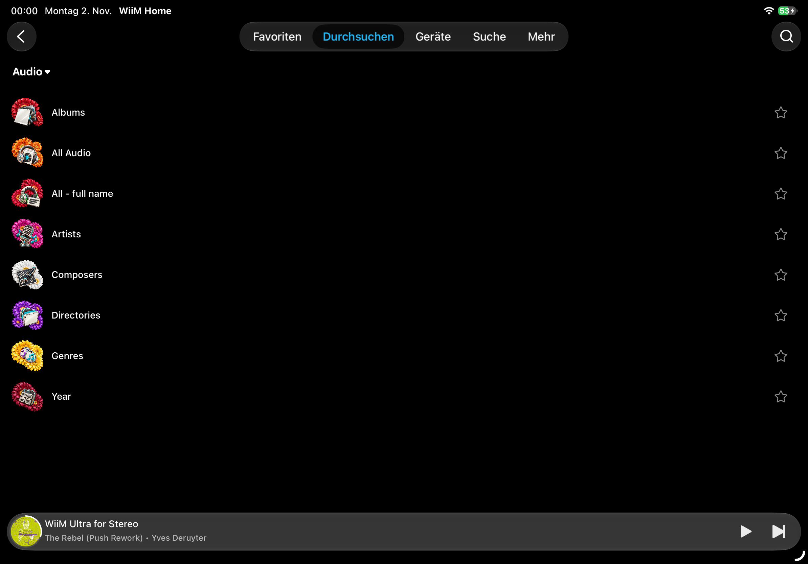

Container icon theme
====================

.. include:: ../artwork/container-icons/README.rst
   :start-after: ====================

WiiM Home on iOS
----------------

The following user-supplied screenshots show the Gerbera theme deployed on
2 November 2026 and displayed by WiiM Home on iOS. Existing stored artwork
was refreshed on that installation; changing the configuration alone does
not rewrite artwork resources already stored in a catalogue.

.. image:: _static/container-icons-wiim-ios.png
   :alt: Gerbera root categories with the flower-based 3D icons in WiiM Home on iOS
   :width: 360px

