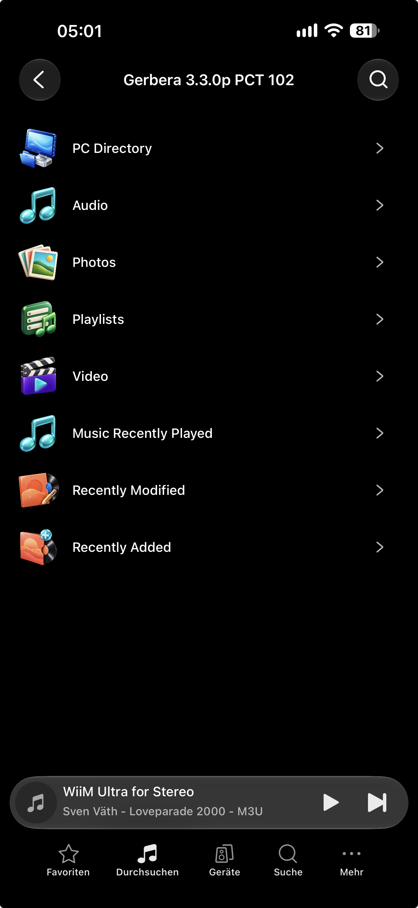

Container icon theme
====================

.. include:: ../artwork/container-icons/README.rst
   :start-after: ====================

WiiM Home on iOS
----------------

The following user-supplied screenshot shows the artwork deployed on an existing
Gerbera installation and displayed by WiiM Home on iOS. It is an appearance
example, not evidence that the unmodified packaged configuration updates every
existing catalogue automatically. The installation used custom configuration
and refreshed existing container artwork.

